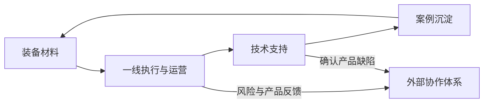

# TrustRocket

TrustRocket 是 RocketOS 下的客户服务、交付支持与客户成功标准体系，与 SpecRocket、GrowthRocket 处于业务执行层同级。

它不是 CRM、工单系统、客服 SaaS、知识库产品或 Agent 平台。它定义可由 Human、AI Agent、Script、Automation、External Service 或人机组合执行的业务契约、项目结构、创世能力与协作规则。

## 核心模型

TrustRocket 只设四个稳定业务域：

| 业务域 | 使命 | 典型产物 |
|:--|:--|:--|
| 装备材料 | 把组织能力转为一线、渠道、客户可直接使用的装备 | 指南、SOP、FAQ、Checklist、培训与验收材料 |
| 技术支持 | 让问题被识别、定位、解决、升级并闭环 | 标准问题描述、诊断记录、处置方案、研发反馈 |
| 案例沉淀 | 把一次性经验转为可复用的组织能力 | 故障案例、交付案例、根因分析、最佳实践、反模式 |
| 一线运营 | 持续掌握客户、POC、交付、售后与客户成功的真实状态 | 风险、重大事项、健康度、趋势与运营汇报 |

四域形成循环：



跨体系只交换标准 Handoff，不依赖其他 Rocket 的内部实现。

## 仓库结构

```text
TrustRocket/
├── AGENTS.md                         # 框架维护协作入口
├── CLAUDE.md                         # Claude Code 引用入口
├── README.md                         # 项目入口
├── SKILL.md                          # /trust-rocket 命令规范
├── init.sh                           # 无 AI 时的初始化入口
├── trust-rocket                      # init / migrate / update / 项目辅助命令
├── trustrocket-convention.zh.md      # 方法论正文
└── template/                         # 业务项目最小骨架
```

框架仓库与初始化后的业务项目是两个层次。四大业务内容目录只存在于 `template/` 和由 Genesis 创建的业务项目中，不用于承载框架源码。

## 快速开始

在当前空目录初始化：

```bash
/path/to/TrustRocket/trust-rocket init .
```

创建新项目：

```bash
/path/to/TrustRocket/trust-rocket init ./customer-success
```

分析已有项目：

```bash
/path/to/TrustRocket/trust-rocket migrate ./existing-project
```

安全补齐入口文件、四域目录、`skills/`，以及已有 Markdown 内容目录缺失的资源目录，不移动或覆盖现有内容：

```bash
/path/to/TrustRocket/trust-rocket migrate ./existing-project --apply
```

校验项目：

```bash
/path/to/TrustRocket/trust-rocket validate ./customer-success
```

无 AI 时也可使用与 SpecRocket 一致的初始化入口：

```bash
/path/to/TrustRocket/init.sh ./customer-success
```

CLI 还提供常用的开发辅助命令：

```bash
# 创建 Markdown，并在同级补齐 source/ 与 cut/
/path/to/TrustRocket/trust-rocket document equipment 部署/快速开始 --title "快速开始" --project ./customer-success

# 在业务域内创建或登记一个独立应用目录
/path/to/TrustRocket/trust-rocket app equipment POC助手 --project ./customer-success

# 登记已放入 source/ 或 cut/ 的素材
/path/to/TrustRocket/trust-rocket material 装备材料/部署/source/user-manual.pdf --origin user --project ./customer-success
```

`init`、`migrate`、项目辅助命令和 `validate` 不会执行 `git init`、提交、推送、打标签或发布。`update` 是唯一会访问远端并快进更新框架仓库的命令，它会在工作区有未提交修改时拒绝执行。

## Genesis 产物

初始化项目包含：

```text
project/
├── AGENTS.md
├── CLAUDE.md
├── README.md
├── .trustrocket.json
├── skills/                     # 用户确认的项目级可复用 Skill
├── 装备材料/
├── 技术支持/
├── 案例沉淀/
└── 一线运营/
```

Genesis 不生成空业务模板文档，也不为没有 Markdown 的目录预建 `source/`、`cut/`。业务内容在真实需求出现时创建；某个目录开始直接承载 Markdown 时，再在同级建立 `source/` 和 `cut/`。

`skills/` 默认为空。当某个处理流程已实际跑通、效果经用户确认且可能多次复用时，可沉淀为 `skills/<skill-name>/SKILL.md`，并按需携带参数化脚本、参考与资源。临时脚本和未验证方案不会被自动沉淀。

## Skill 命令

`SKILL.md` 以与 SpecRocket 相同的单一 Skill 入口组织以下能力：

| 命令 | 能力 |
|:--|:--|
| `/trust-rocket init` | 初始化空项目 |
| `/trust-rocket migrate` | 安全规范化已有项目 |
| `/trust-rocket update` | 更新 TrustRocket 框架仓库 |
| `/trust-rocket document` | 创建 Markdown 内容和同级 source/cut |
| `/trust-rocket app` | 创建或登记业务域内的应用目录 |
| `/trust-rocket material` | 登记素材来源与二进制授权 |
| `/trust-rocket skill` | 经用户确认后沉淀稳定可复用流程 |
| `/trust-rocket equipment` | 创建、改写、校验装备材料 |
| `/trust-rocket support` | 问题受理、诊断、解决、升级和验证 |
| `/trust-rocket case` | 检索、创建、合并、改进案例并反哺装备 |
| `/trust-rocket operations` | 收集外部状态、识别风险和分发反馈 |
| `/trust-rocket validate` | 校验目录、项目级 Skill、Markdown、素材、状态与配置边界 |

Skill 是执行说明，不是业务事实源。权威方法论位于 `trustrocket-convention.zh.md`；初始化项目的业务契约和 Agent 入口统一位于 `AGENTS.md`。没有 AI 时，人也可直接按方法论和项目契约执行。

## 规则优先级

1. 使用者对当前任务的明确指令
2. 目标项目的 `AGENTS.md` 与 `.trustrocket.json`
3. 本仓库 `trustrocket-convention.zh.md` 的 TrustRocket 方法论
4. `SKILL.md` 的执行指南
5. 行业方法与执行者经验

行业术语不得覆盖明确业务规则。

## 文本与素材

- 默认使用 Markdown、JSON、YAML、TOML、CSV、Mermaid 与脚本。
- `source/` 与 `cut/` 专门服务同级 Markdown：原件放入 `source/`，从原件切出的独立资源放入 `cut/`。
- 用户提供的素材使用 `user-` 前缀；公共来源不使用该前缀。
- 一个目录直接包含 Markdown 时，必须同时存在同级 `source/`、`cut/`；没有 Markdown 时默认不建立。
- 四域内允许按业务需要创建普通子目录。基于文档创建的小程序或应用，其内部目录遵循代码项目自身规范，不套用文档资源目录规则。
- 默认不生成 DOCX、XLSX、PPTX、PDF 或图片包装；使用者明确要求时可以生成，同时优先保留文本事实源。

## Git 边界

TrustRocket 及其 Skills 默认只允许读取 Git 状态与历史。提交、推送、标签、合并、变基和发布必须由使用者明确要求；Genesis 与 Validator 不执行任何 Git 写操作。
